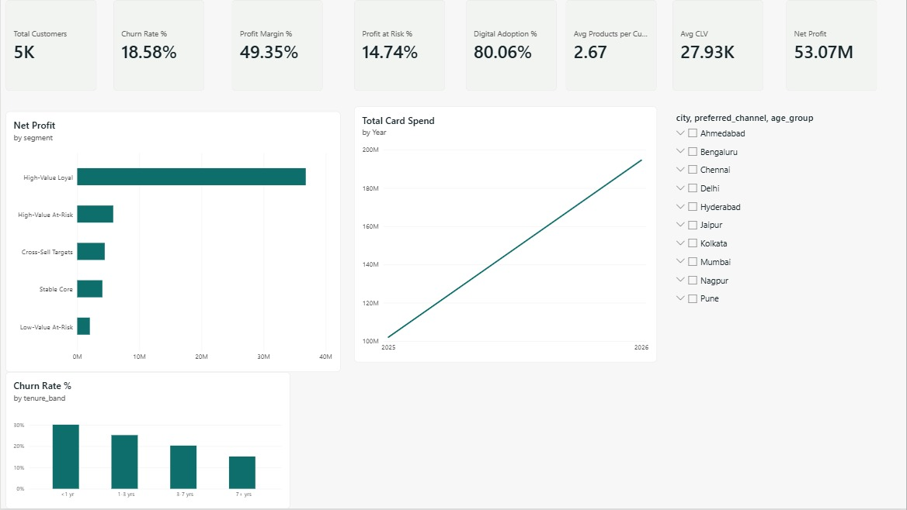

# Retail Banking Customer Analytics & Profitability Intelligence

End-to-end analytics project on a retail bank's customer base: **SQL** for the analytical layer, **Python** for churn
modelling, customer lifetime value and segmentation, a **FastAPI + web dashboard** for live exploration, and a
**Power BI** report with 26 KPIs.

It identifies what drives profitability, which customers are about to leave, which of them are worth saving,
and where cross-sell opportunities sit.

> The data is **synthetic** (5,000 customers, 12 months, INR) and generated with a fixed seed, so every result is reproducible.
> Profitability assumptions (spreads, fees, cost-to-serve) are documented in `sql/01_views.sql`.
>
> 

## Architecture
```
generate_data.py -> data/raw/*.csv -> etl.py -> SQLite (data/bank.db) + SQL views
                                                   |
                       analytics.py: features -> churn model -> CLV -> segments -> cross-sell
                                                   |
        +-------------------+----------------------+--------------------+
   customer_scored (SQL)   reports/ (metrics + figures)         powerbi/data/*.csv
        |
   FastAPI (src/api.py) -> web/index.html dashboard            Power BI report
```

## Quick start
```bash
python -m venv .venv && source .venv/bin/activate     # Windows: .venv\Scripts\activate
pip install -r requirements.txt
python run_pipeline.py                                 # data -> SQLite -> model -> exports
uvicorn src.api:app --reload                           # http://127.0.0.1:8000
$env:PYTHONPATH="."; python tests/smoke_api.py     # Windows PowerShell
```

## What it does
| Area | Implementation |
|---|---|
| Profitability drivers | SQL views compute revenue (deposit and loan margin, card interest, interchange, fees), cost-to-serve and credit cost per customer |
| Customer lifetime value | 5-year CLV: annual profit discounted at 10%, weighted by model-implied retention |
| Churn patterns | SQL breakdowns by credit utilization, tenure, channel and product holding |
| Churn model | Logistic regression vs gradient boosting, stratified hold-out plus 5-fold CV, ROC/PR AUC, precision/recall/F1, confusion matrix, permutation importance, decile lift |
| Segmentation | High-Value Loyal, High-Value At-Risk, Low-Value At-Risk, Cross-Sell Targets, Stable Core, each with a recommended retention action |
| Cross-sell | Rule-based next best product from income, age, tenure, balances and holdings |
| Dashboard | KPI strip, segment profit, churn drivers, product mix, save list, model evaluation |
| Power BI | 4-table star schema, 26 DAX measures, 3 report pages (see `powerbi/README.md`) |

## Results (seed 42)
- 5,000 customers, **18.6% churn**, **49% profit margin**, ₹5.3 Cr annual profit.
- Best churn model: logistic regression, **ROC AUC 0.756** on held-out data (5-fold CV AUC 0.768), well ahead of random.
  The top 10% of customers by predicted risk churn at about 2.9x the average rate.
- Churn climbs sharply with credit utilization: 14% below 30% utilization, 37% at 60-80%, 49% above 80%.
- New customers are the most fragile: 30% churn under one year of tenure vs 15% after seven years.
- High-Value At-Risk customers are 180 people holding about ₹58 L of annual profit, which is the save list.
- Scores are out-of-fold, so no customer is scored by a model that trained on them.

Because the data is synthetic, treat the numbers as a demonstration of method, not as banking benchmarks.

## Project layout
```
run_pipeline.py        one-command pipeline
sql/01_views.sql       indexes, activity, product and profitability views
sql/02_queries.sql     named analytical queries (also served by the API)
src/                   generate_data, etl, analytics, db, api
web/index.html         dashboard
powerbi/               data exports, measures.dax, theme.json, build guide
reports/               metrics.json and figures (ROC, importance, lift)
tests/smoke_api.py     endpoint smoke test
```

## Using your own data
Replace the three CSVs in `data/raw/` (`customers`, `products`, `monthly_activity`; same columns), then run:
python -m src.etl
python -m src.analytics
Do not run `run_pipeline.py`: it regenerates synthetic data and overwrites your CSVs.

## Publish to GitHub
```bash
git init && git add . && git commit -m "Retail banking customer analytics and profitability intelligence"
git branch -M main && git remote add origin https://github.com/<your-username>/retail-banking-analytics.git
git push -u origin main
```
After you build the report, add a Power BI screenshot to `reports/figures/` and link it in this README.
